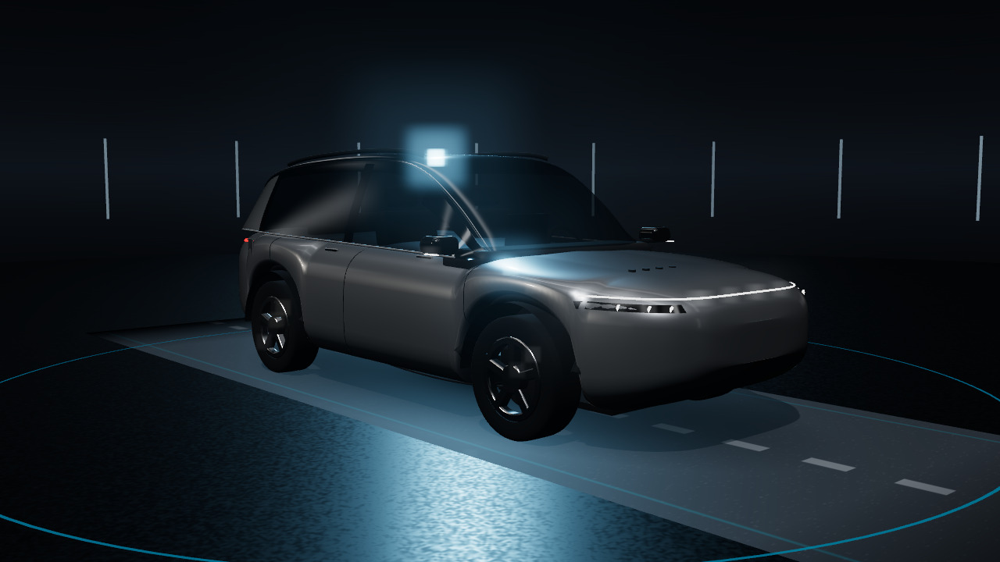

# PHEV por dentro · Simulador

Simulador 3D, no navegador, de um SUV híbrido plug-in. Mostra como a bateria é recarregada, como os dados saem pela porta OBD-II e como os sinais do veículo chegam à central multimídia. Desenvolvido pelo grupo [Conect2ai](https://conect2ai.dca.ufrn.br/) da UFRN.

**Acesse:** https://conect2ai.github.io/phev-simulator/



## O que dá para fazer

**Recarga**
- Escolher a fonte de energia (tomada 220 V, wallbox AC ou carregador rápido DC) e ver o caminho da energia até a bateria. Na AC a energia passa pelo carregador de bordo, e na DC vai direto para a bateria.
- Ajustar a potência do carregador DC, o limite de recarga, o estado de carga e a temperatura ambiente. A curva de potência cai acima de 80% e com a bateria fria ou quente demais.
- Dirigir nos modos Elétrico, Híbrido e Recarga em movimento, com três níveis de regeneração e frenagem.
- Acelerar o tempo da simulação (1×, 10× e 60×).

**OBD-II**
- Ler PIDs padronizados do modo 01 (velocidade, rotação, carga da bateria híbrida, temperaturas e combustível).
- Ler dados do fabricante via UDS 0x22 (SoC real, tensão, corrente, temperatura e células). Os identificadores são ilustrativos.
- Ler o VIN (com quadros ISO-TP de várias partes), ler e apagar falhas (modos 03 e 04) e simular falhas como isolamento de alta tensão.
- Ativar um gateway de segurança que bloqueia os dados do fabricante (resposta negativa 0x33).

**Multimídia**
- Escolher quais sinais o gateway repassa para a rede de infotainment e ver o efeito na tela da central.
- Mudar o período das mensagens da BMS e observar o atraso até a tela.
- Acompanhar as propriedades do Android Automotive (`EV_BATTERY_LEVEL`, `EV_CHARGE_STATE`, `PERF_VEHICLE_SPEED` e outras) no modo técnico.
- Ampliar a tela da central e alterar o limite de recarga por ela (`EV_CHARGE_PERCENT_LIMIT`).

**Geral**
- Tour guiado com 12 etapas. Para abrir direto no tour, use o endereço terminado em `#tour`.
- Raio-X da carroceria, modo técnico com o log CAN, interface em português e inglês, três níveis de qualidade gráfica e layout para celular.

## Dados de referência

O modelo 3D é original e ilustrativo. As dimensões e os dados técnicos seguem as informações públicas do Geely EX5 EM-i vendido no Brasil pela Renault Geely do Brasil (2026).

| Item | Pro / Max | Ultra |
|---|---|---|
| Bateria | 18,4 kWh LFP | 29,8 kWh |
| Recarga AC | 6,6 kW | 6,6 kW |
| Recarga DC | 30 kW (30% a 80% em cerca de 20 min) | 60 kW (30% a 80% em cerca de 16 min) |
| Motor elétrico | 160 kW, 262 Nm | 160 kW, 262 Nm |
| Motor a combustão | 1.5 aspirado | 1.5 aspirado |
| Dimensões | 4.740 × 1.905 × 1.685 mm, entre-eixos 2.755 mm | idem |

Curvas de recarga, tensões, identificadores CAN, DIDs e o consumo são simulados para fins didáticos e não representam a calibração real do veículo.

Fontes: [O POVO](https://www.opovo.com.br/noticias/veiculos/2026/04/16/amp/geely-lanca-ex5-hibrido-com-autonomia-de-1-300-km-partindo-de-rs-1999-mil.html), [Canal VE](https://canalve.com.br/ficha-tecnica/geely/tudo-sobre-ex5-em-i/), [AutoIndustriya](https://www.autoindustriya.com/auto-industry-news/here-are-more-specs-of-geely-ex5-phev-for-ph.html), [Android Automotive VehiclePropertyIds](https://developer.android.com/reference/android/car/VehiclePropertyIds).

## Como publicar no GitHub Pages

1. Crie o repositório público `conect2ai/phev-simulator` no GitHub.
2. Envie todos os arquivos desta pasta para a branch `main`, mantendo a estrutura. Pela interface web, use **Add file → Upload files** e arraste o conteúdo da pasta (não a pasta em si). Pela linha de comando:
   ```bash
   git init && git add . && git commit -m "feat: simulador PHEV por dentro"
   git branch -M main
   git remote add origin https://github.com/conect2ai/phev-simulator.git
   git push -u origin main
   ```
3. No repositório, abra **Settings → Pages**. Em **Build and deployment**, escolha **Deploy from a branch**, branch `main` e pasta `/ (root)`, e salve.
4. Em um ou dois minutos o site fica disponível em `https://conect2ai.github.io/phev-simulator/`.

O arquivo `.nojekyll` já está incluído para que o GitHub sirva a pasta `vendor` sem processamento.

## Como rodar localmente

O simulador usa módulos JavaScript, então precisa de um servidor local (abrir o `index.html` direto do disco não funciona):

```bash
python3 -m http.server 8000
```

Depois acesse `http://localhost:8000`.

## Estrutura

```
index.html          página e importmap
css/app.css         interface
js/main.js          interface, tour guiado e laço principal
js/scene.js         renderização, estúdio, estações de recarga e fluxos de partículas
js/vehicle.js       veículo procedural, materiais e raio-X
js/sim.js           modelo de energia, recarga e condução
js/obd.js           quadros CAN, PIDs, UDS, DTCs e mensagens periódicas
js/hu.js            telas da central multimídia, painel e carregador DC
js/i18n.js          textos em português e inglês
vendor/three/       Three.js r160 (licença MIT)
```

## Créditos

Conect2ai, Departamento de Engenharia de Computação e Automação, Universidade Federal do Rio Grande do Norte (UFRN). Renderização com [Three.js](https://threejs.org/).

---

## English

Browser-based 3D simulator of a plug-in hybrid SUV covering AC/DC charging, OBD-II diagnostics (SAE J1979 PIDs, UDS 0x22, DTCs, ISO-TP) and how vehicle signals reach an Android Automotive head unit. Use the **PT/EN** button to switch languages. The 3D model is original and illustrative; specifications follow public data for the Geely EX5 EM-i sold in Brazil, and all CAN identifiers, DIDs and curves are simulated for teaching purposes.
